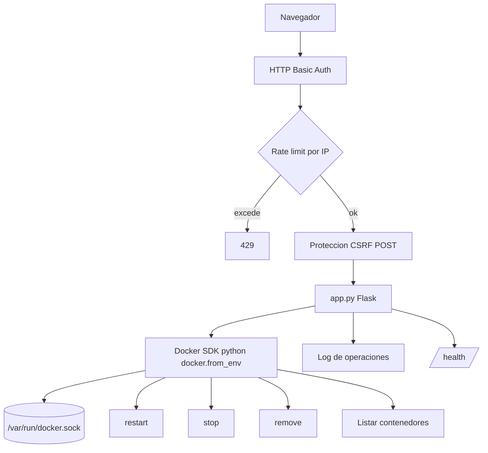

# docker-web-manager

Gestor de contenedores Docker ligero basado en web. Proporciona una interfaz Flask sencilla para listar, iniciar, detener, reiniciar y eliminar contenedores Docker.

[](LICENSE)
[](https://python.org)
[](https://flask.palletsprojects.com/)
[](https://docs.docker.com/engine/api/sdk/)
[](https://github.com/bi0punk/docker-web-manager/actions/workflows/ci.yml)

## Contenido

- [Características](#características)
- [Arquitectura](#arquitectura)
- [Stack](#stack)
- [Estructura del repositorio](#estructura-del-repositorio)
- [Requisitos](#requisitos)
- [Instalación](#instalación)
- [Uso](#uso)
- [Configuración](#configuración)
- [Tests / CI](#tests--ci)
- [Seguridad](#seguridad)
- [Roadmap](#roadmap)
- [Licencia](#licencia)

## Características

- Listado completo de contenedores (running + stopped).
- Acciones: stop, restart, remove containers.
- Interfaz web limpia con Bootstrap.
- Autenticación HTTP Basic.
- Protección CSRF en todos los formularios POST.
- Rate limiting por IP en endpoints críticos.
- Logging de operaciones (login, stop, restart, remove).
- Health check endpoint (`/health`).
- Conexión al socket Docker local.

## Arquitectura



## Stack

| Componente | Tecnología |
|---|---|
| Lenguaje | Python 3.11+ |
| Web | Flask 3.1 |
| Docker | Docker SDK for Python (docker-py 7.1) |
| Config | python-dotenv |
| Testing | pytest + ruff |

## Estructura del repositorio

```
docker-web-manager/
├── app.py             # Aplicación Flask + endpoints Docker
├── templates/
│   └── index.html     # UI con Bootstrap
├── tests/
│   └── test_smoke.py
├── .env.example
├── requirements.txt
└── pyproject.toml
```

## Requisitos

- Python 3.11+.
- Docker Engine (socket `/var/run/docker.sock`).
- El usuario que ejecuta la app debe tener permisos sobre el socket Docker.

## Instalación

```bash
git clone https://github.com/bi0punk/docker-web-manager.git
cd docker-web-manager
python -m venv .venv && source .venv/bin/activate
pip install -r requirements.txt
```

## Uso

```bash
cp .env.example .env
# Editar credenciales y secretos en .env
python app.py
```

Abrir `http://localhost:5000` e iniciar sesión con las credenciales configuradas. La interfaz muestra todos los contenedores con botones para gestionarlos.

## Configuración

| Variable | Default | Descripción |
|---|---|---|
| `DWM_USER` | — | Usuario HTTP Basic Auth. |
| `DWM_PASS` | — | Contraseña HTTP Basic Auth. |
| `DWM_SECRET` | — | Secret key de Flask para sesiones/CSRF. |
| `DWM_HOST` | `127.0.0.1` | Host de escucha. |
| `DWM_PORT` | `5000` | Puerto. |
| `DWM_RATE_LIMIT` | `30` | Peticiones máximas por minuto por IP. |

## Tests / CI

```bash
pip install pytest ruff
pytest -q
ruff check .
```

GitHub Actions ejecuta ruff lint + pytest en cada push y PR sobre Python 3.11.

## Seguridad

- HTTP Basic Authentication en todos los endpoints.
- Protección CSRF con tokens de sesión en formularios POST.
- Rate limiting (30 req/min por IP).
- Logging de eventos de seguridad (login, operaciones críticas).
- El socket Docker se expone a la web — restringir acceso a redes de confianza.
- Cambiar credenciales antes de desplegar.
- Ejecutar detrás de un reverse proxy con HTTPS en producción.

## Roadmap

- [x] Gestión básica de contenedores con autenticación y CSRF
- [ ] Soporte para Docker Compose (up/down stacks)
- [ ] Logs en vivo por contenedor vía WebSocket
- [ ] Estadísticas de uso (CPU, memoria, red)
- [ ] Manejo de imágenes (pull, build, remove)

## Licencia

MIT — ver [LICENSE](LICENSE).